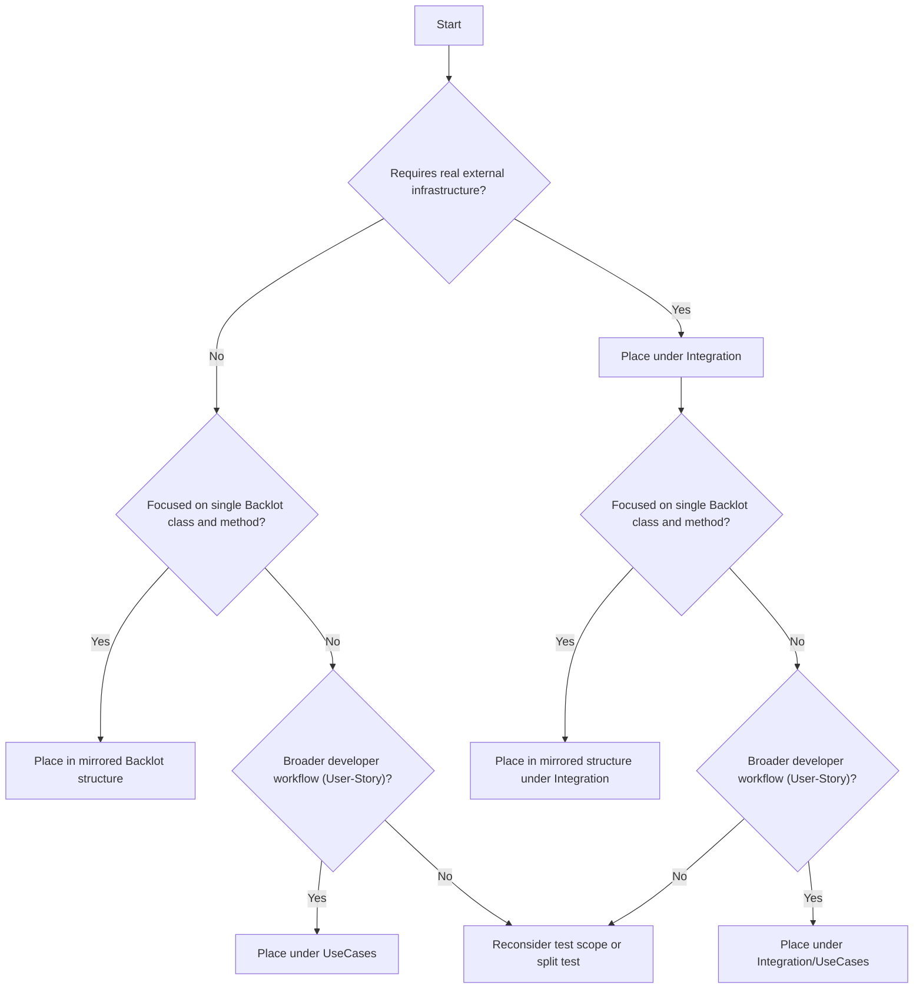

This document defines the structure and conventions for tests in `Backlot.Testing`.

The goal is to keep the test suite predictable, maintainable and useful as documentation.

### Adding a new test

Before adding a test:

1. Identify the Backlot behaviour or developer use case being verified and decide the appropriate test type using [Deciding Where a Test Belongs](#3-deciding-where-a-test-belongs).
2. Identify meaningful test cases using the contract, equivalence partitions, boundaries or condition combinations. See [Identifying Test Cases](#63-identifying-test-cases).
3. Place the test in the correct folder and namespace using the [Proposed Project Structure](#2-proposed-project-structure).
4. Follow the applicable [Naming Conventions](#4-naming-conventions)
5. Implement the test using [Arrange, Act, Assert](#5-arrange-act-assert) and follow the [Do's and Don'ts](#6-dos-and-donts).

## 1\. Test organisation

Tests are organised by the behaviour they are intended to verify, not by Backlot components that execute during the test.

There are three main types of tests:

### Method-focused tests

A method-focused test verifies the contract or behaviour of one Backlot method.

The Backlot project and namespace structure is mirrored in `Backlot.Testing`. The Backlot class becomes a folder and each tested method gets its own test file.

Example:

```text
Backlot:
Backlot.Defaults/
└── Instructing/
    └── MustachExpressionEngine.cs

Tests:
Backlot.Testing/
└── Defaults/
    └── Instructing/
        └── MustachExpressionEngine/
            └── Execute.cs
```

```csharp
namespace Backlot.Testing.Defaults.Instructing.MustachExpressionEngine;

public class Execute
{
}
```

### Use-case tests

Use-case tests describe a realistic workflow or behaviour from the perspective of a Backlot user/developer. They may deliberately combine multiple public Backlot behaviours, such as role presentation, scenarios, persistence, relations or serialization.

Use-case tests live under:

```text
Backlot.Testing/
└── UseCases/
```

They are organised by capability or use case rather than by a single Backlot class.

Examples of existing areas that fit this category include complex actor handling, optional role resolution (NullAllowed) and transformations.

### Integration tests

`Integration/` is reserved for tests that intentionally depend on real external infrastructure, for example:

- SQL;
- RavenDB;
- a real filesystem;
- external services.

## 2\. Proposed project structure

```text
Backlot.Testing/
│
├── Core/
│   └── ...Backlot namespaces...
│       └── BacklotClass/
│           ├── MethodOne.cs
│           └── MethodTwo.cs
│
├── Defaults/
│   └── ...Backlot namespaces...
│       └── BacklotClass/
│           └── Method.cs
│
├── UseCases/
│   ├── <Workflow/UseCase>/
│   │   └── <UseCaseName>.cs
│   └── ...
│
├── Shared/
│   ├── Bootstrap/
│   ├── Builders/
│   ├── Fakes/
│   ├── Scenarios/
│   ├── Stubs/
│   ├── TestData/
│   └── TestModels/
│
└── Integration/
```

Namespaces follow the folder structure.

Only place code in `Shared` when it is genuinely reused or represents reusable test infrastructure. Scenario-specific setup should remain close to the tests that use it.

## 3\. Deciding where a test belongs

Use the following decision tree to determine where a test belongs based on its infrastructure dependencies and intended behaviour.



## 4\. Naming Conventions

### 4.1\. Method-focused test conventions

#### File and fixture naming

The Backlot class is represented by a folder.

Each tested method gets its own file:

```text
Backlot.Testing/
    Loader/
    ├── GetRoleName.cs
    ├── GetRoleByName.cs
    └── TryGetRoleByName.cs
```

The file name and fixture name are the same:

```csharp
public class GetRoleName
{
}
```

#### Test method naming

Use:

```text
MethodName_StateUnderTest_ExpectedBehavior
```

Examples:

```csharp
GetRoleName_InterfaceStartsWithI_ReturnsNameWithoutPrefix()
Persist_RoleWithoutWritePermission_ThrowsPermissionControlException()
Execute_TypedActor_RendersExpressionValues()
Presents_AnonymousActor_ReturnsJsonProxy()
```

Names must describe the current behaviour of the system. Avoid vague names such as `Example`, `Debugging` or names that no longer match the assertion.

### 4.2\. Use-case test conventions

A use-case fixture represents one clear developer/user goal.

#### User story

Document the use case at the top of the fixture using:

```text
As a [persona],
I want [goal],
So that [reason].
```

Example:

```csharp
/// <summary>
/// As a Backlot developer,
/// I want supporting roles to be optional,
/// so that a scenario can execute when a related role is not available.
/// </summary>
public class OptionalRelatedRole
{
}
```

The user story explains why the fixture exists. It should describe behaviour from the consumer's perspective rather than implementation details.

#### Scenario naming (Gherkin)

Each individual test represents a scenario using **Given** / **When** / **Then**.

Use:

```text
Given<State>_When<Action>_Then<ExpectedOutcome>
```

Examples:

```csharp
GivenMissingRelatedRole_WhenScenarioWithoutNullAllowedIsPlayed_ThenArgumentExceptionIsThrown()

GivenMissingRelatedRole_WhenScenarioWithNullAllowedIsPlayed_ThenScenarioExecutes()

GivenPersistedRelatedRole_WhenScenarioIsPlayed_ThenRelatedRoleIsResolved()
```

Keep the name focused on the behaviour. If a scenario needs multiple unrelated `And` clauses to explain the expected result, consider whether it should be split into separate tests.

#### Gherkin and AAA

**Given** / **When** / **Then** describes the scenario from a behavioural perspective.

**AAA** remains the code structure used to implement the test. See [Arrange, Act, Assert](#5-arrange-act-assert).

### 4.3\. Terminology

Use the following terminology consistently:

- **Dummy:** only fills a required parameter; its behaviour is not used. A Backlot example is an unconfigured `Substitute.For<IConfigurationManager>()` passed to a test Director when configuration behaviour is irrelevant to the test.
- **Fake:** a simplified but working implementation. `MemoryPersistedRoleRepository` and `MemoryRelationRepository` are good Backlot examples: they provide real repository behaviour in memory without an external database.
- **Stub:** returns predefined values needed to drive a test. `ConfigStub` returns fixed configuration values, while `PersistedRoleRepositoryStub` can be configured through `SetTryGet` and `TryGetOutRole` to simulate an existing or missing persisted role.
- **Mock:** is used when the interaction with a dependency is itself part of the behaviour being verified. For example, when testing that a workflow creates a relation, an `IRelationRepository` NSubstitute can be verified with `Received(1)`.

Example mock interaction:

```csharp
var relations = Substitute.For<IRelationRepository>();

// Act
await sut.Execute(...);

// Assert
await relations.Received(1).Add(Arg.Any<Relation>());
```

Use NSubstitute when an interaction-verifying mock is appropriate. Prefer a simple concrete fake/stub when it makes the test easier to understand.

## 5\. Arrange, Act, Assert

Use simple AAA comments:

```csharp
// Arrange

// Act

// Assert
```

Do not add an empty Arrange section when no setup is required.

```csharp
[Test]
public void GetRoleName_InterfaceStartingWithI_ReturnsNameWithoutPrefix()
{
    // Act
    var result = Loader.GetRoleName(typeof(IInterfaceStartingWithI));

    // Assert
    Assert.That(result, Is.EqualTo("InterfaceStartingWithI"));
}
```

A test normally has one central Act. A broader user-story/use-case test may require multiple calls when those calls together represent one workflow.

For exception tests, Act and Assert may be combined. See [Async Tests](#62-async-tests) for an example of testing asynchronous exceptions.

### 5.1\. Assertions

Use NUnit constraint syntax consistently:

```csharp
Assert.That(actual, Is.EqualTo(expected));
Assert.That(result, Is.True);
Assert.That(value, Is.Null);
Assert.That(text, Does.Contain("value"));
```

Prefer constraint-based assertions over boolean expressions:

```csharp
// Preferred
Assert.That(actual, Is.EqualTo(expected));

// Avoid
Assert.That(actual == expected);
```

Besides keeping the suite consistent, the constraint form makes the intention of the assertion explicit and produces more useful failure output. NUnit can report the expected and actual values separately, which makes a failing test easier to understand and debug.

Use `Assert.Multiple` when several assertions together verify one behaviour:

```csharp
Assert.Multiple(() =>
{
    Assert.That(result.Number1, Is.EqualTo(10));
    Assert.That(result.Number2, Is.EqualTo(9));
    Assert.That(result.Operation, Is.EqualTo("sum"));
});
```

`Assert.Multiple` should not be used to combine unrelated behaviours in one test.

## 6\. Do's and Don'ts

### 6.1\. General guidelines

- Test one clear behaviour per test.
- Keep setup as small as reasonably possible.
- Keep test data deterministic.
- Do not keep debug tests, commented-out assertions or obsolete test code.
- Comments should explain why something is required, not repeat what the code already says.
- Tests should be readable as documentation of current Backlot behaviour.
- Shared helpers should reduce duplication without hiding the state being tested.
- New tests should follow these conventions. Existing tests can be migrated incrementally while the test suite is restructured.

### 6.2\. Async tests

Async Backlot behaviour should be tested using `async Task` and `await`.

Do not use:

```csharp
.Wait();
.Result;
.GetAwaiter().GetResult();
```

Blocking an asynchronous call makes the test harder to read, can hide the original exception behind wrapper exceptions such as `AggregateException`, and can introduce blocking/deadlock behaviour that is unrelated to the contract.

Do not use manual `try/catch` with `Assert.Pass()` or `Assert.Fail()` to test expected exceptions. This adds unnecessary control flow and makes it easier for a test to pass or fail for the wrong reason.
When testing an expected exception, use NUnit's Assert.ThrowsAsync, which handles the asynchronous delegate internally.

Use NUnit's async exception assertions:

```csharp
// Act & Assert
var exception = Assert.ThrowsAsync<PermissionControlException>(
    async () => await repository.Persist(role));

Assert.That(exception.Message, Does.Contain("permissions"));
```

This keeps the expected exception type explicit and preserves the original asynchronous behaviour.

### 6.3\. Identifying test cases

Do not invent input variations arbitrarily. Derive test cases from the contract and the meaningful input categories supported by the code.

Use the following techniques where appropriate:

#### Equivalence partitioning

Group inputs that represent meaningfully different supported behaviours and choose representative cases from each group.

For example, actor representation can be relevant to Backlot behaviour. Backlot currently has separate role-creation strategies for representations such as:

- self roles;
- dictionaries;
- anonymous objects;
- typed objects;
- JSON/JContainer-based actors.

Only test all representations when the representation is part of the behaviour being verified. Do not repeat the complete actor matrix for every method without a reason.

#### Boundary value analysis

For ranges, limits, counts or similar constraints, test meaningful boundaries rather than many arbitrary values.

#### Decision tables

When behaviour depends on a combination of conditions, define the relevant combinations before implementing the tests.

This can be useful for areas such as permissions or persistence where multiple conditions influence the expected result.
